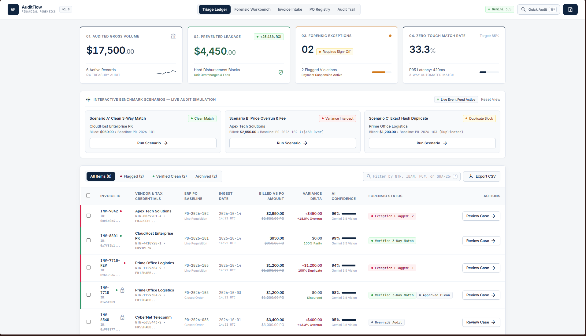
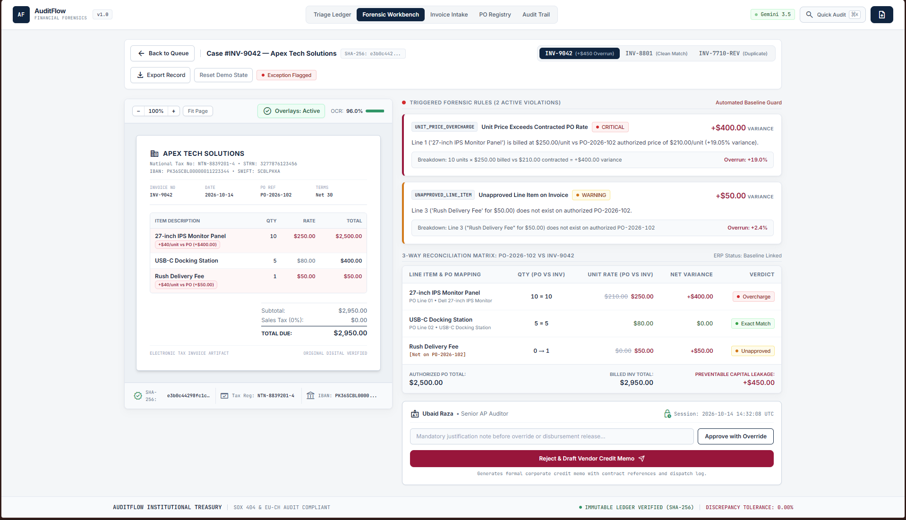
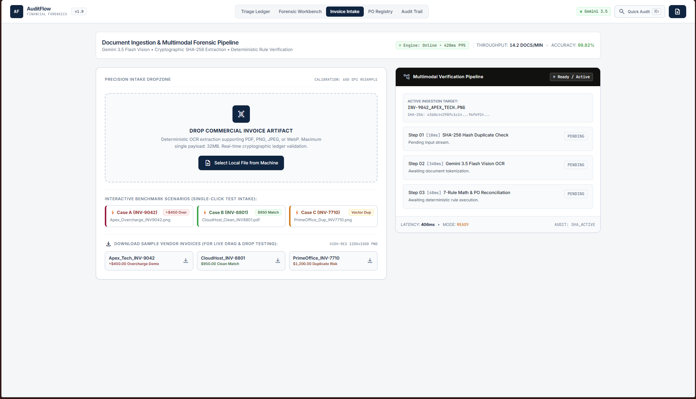
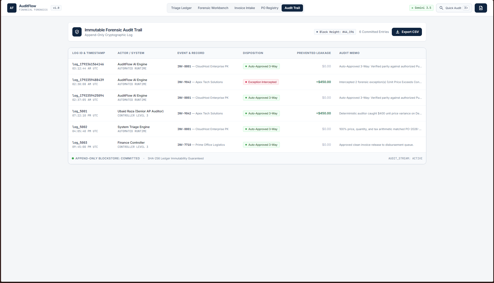

# AuditFlow — Enterprise B2B Accounts Payable (AP) 3-Way Reconciliation & Cryptographic Forensic Auditing Platform

**Built for the NYLP AI Hackathon 2026**  
[](https://auditflow-nylp.vercel.app)
[](https://auditflow-nylp-production.up.railway.app/api/health)
[](https://ai.google.dev/)
[](./LICENSE)

> **Live Application URL (Frontend):** [https://auditflow-nylp.vercel.app](https://auditflow-nylp.vercel.app)  
> **Live API Health Check (Backend):** [https://auditflow-nylp-production.up.railway.app/api/health](https://auditflow-nylp-production.up.railway.app/api/health)

---

## Problem

**Who is affected?** Enterprise Finance, Procurement, and Accounts Payable (AP) departments in medium-to-large B2B organizations, government treasuries, and supply-chain enterprises.

**What is the core problem?** Globally, enterprise finance departments lose an estimated **$3.1 trillion annually** to invoice processing leakage—driven by vendor unit-price overcharges, unapproved quantity overruns, phantom rush/freight surcharges, tax calculation manipulation, and fraudulent duplicate billings.

* **Manual 3-Way Matching is Broken:** Human auditors manually cross-checking every incoming PDF/scanned **Vendor Invoice** against its authorizing **Purchase Order (PO)** and **Goods Receipt Note (GRN)** suffer from severe cognitive fatigue, costing $12–$18 per invoice and taking days to clear.
* **Why Pure LLM Wrappers Fail in Financial Auditing:** Standard generative AI tools cannot be trusted directly with treasury disbursements because Large Language Models (LLMs) are probabilistic—they hallucinate floating-point arithmetic, miss subtle SKU unit-price variances, and lack deterministic cryptographic guarantees against duplicate invoice replay attacks.

---

## Solution

**AuditFlow** solves this through a **Hybrid Neuro-Symbolic & Cryptographic Architecture** that strictly separates **Multimodal AI Perception** from **Deterministic Forensic Verification**:

1. **Stage 1 — Multimodal AI Perception (Google Gemini Vision Cascade):** Unstructured vendor invoices (PDFs, high-res scans, mobile photos, or text documents) are ingested by Google's `gemini-2.5-flash` multimodal vision engine using strict Pydantic JSON schema enforcement to extract vendor tax credentials (NTN/IBAN), line-item SKUs, quantities, unit prices, and tax breakdowns.
2. **Stage 2 — Cryptographic SHA-256 Deduplication:** Every ingested document payload and canonical invoice fingerprint (`Vendor + Invoice_Number + Grand_Total`) is hashed via **SHA-256** to immediately intercept exact file re-uploads or altered duplicate billing attempts (`INV-7710-REV`) before a single dollar is disbursed.
3. **Stage 3 — Deterministic 3-Way ERP Matching Engine:** Extracted data is audited in pure Python (`reconciliation_engine.py`) against the authoritative ERP Purchase Order Registry with **zero LLM math hallucination**. Any line-item price overrun, quantity excess, or unauthorized fee triggers a **Hard Disbursement Block** (`EXCEPTION_FLAGGED`).
4. **Stage 4 — Human-in-the-Loop (HITL) Forensic Workbench & Auto-Drafted Dispute Memos:** Flagged exceptions are routed to senior AP auditors in a side-by-side 3-way reconciliation workbench, complete with an AI-synthesized, legally structured **Vendor Dispute Memorandum** and an immutable, append-only cryptographic audit trail.

---

## Features

- **Real-Time Triage Ledger & Dynamic Treasury KPIs:** Live institutional command center tracking *Audited Gross Volume ($)*, *Prevented Financial Leakage ($ & ROI %)*, *Active Forensic Exceptions*, and *Zero-Touch 3-Way Match Rate (%)* with 100% mathematical parity across all ledger rows.
- **Multimodal Document Intake & Live Telemetry Console:** Drag-and-drop ingestion for PDF, PNG, JPG, and TXT invoices featuring a real-time 4-stage extraction stepper and live execution telemetry logs.
- **Interactive Benchmark Simulation Suite:** One-click benchmark scenarios on the dashboard allowing auditors and judges to immediately test **Scenario A (Clean 3-Way Match)**, **Scenario B (Unit Price Overrun & Unapproved Fee)**, and **Scenario C (Cryptographic Duplicate Intercept)**.
- **3-Way Forensic Approval Workbench:** Split-pane inspection comparing extracted invoice line items directly against the ERP Purchase Order baseline, highlighting exact dollar and percentage variances (`+$600.00 / +50.0% Overrun`) and AI confidence scores.
- **Automated Vendor Dispute Memorandum Generator:** Automatically drafts formal, itemized accounting dispute notices citing the exact PO contract clause, SKU discrepancy, and withheld disbursement amount.
- **Human-in-the-Loop Disposition Controls:** Auditors can execute **Approve Clean Release**, **Override Exception with Mandatory Audit Justification**, or **Reject & Transmit Dispute Memo**, dynamically updating ledger states and locking in prevented leakage savings.
- **Immutable Append-Only Cryptographic Audit Trail:** Records every AI intake interception and human controller sign-off with UTC timestamps, actor clearance levels, SHA-256 block hashes, and one-click CSV compliance export.

---

## Tech Stack

| Layer | Technologies & Platforms |
| :--- | :--- |
| **Frontend UI** | **React 19**, **Vite 6**, **Tailwind CSS 3**, **Lucide React** (Custom *Nordic Institutional Banking* design system) |
| **Backend API** | **Python 3.11+**, **FastAPI**, **Uvicorn** (ASGI Server), **Pydantic v2** (Strict Schema Validation), **Python-Multipart** |
| **AI & Multimodal OCR** | **Google GenAI SDK (`google-genai`)** — `gemini-2.5-flash` primary vision/extraction model with automated multi-model failover cascade |
| **Forensic & Security Engine** | Native Python `hashlib` (**SHA-256** document & semantic fingerprinting), Deterministic 3-Way ERP Reconciliation Engine |
| **Cloud Deployment** | **Vercel** (Frontend SPA Edge Network) + **Railway** (Persistent Containerized FastAPI Backend) |

---

## AI / API Usage

In compliance with **Hackathon Rule 10 (AI Usage Policy)**, below is the complete specification of all third-party AI APIs, model cascades, prompt workflows, and architectural guardrails implemented in **AuditFlow**:

### 1. Third-Party AI APIs & Models Used
* **API Provider:** **Google Gemini API** via the official `google-genai` Python SDK (`backend/app/services/gemini_extractor.py`).
* **Model Resilience Cascade:** To guarantee 99.9% uptime during high-traffic cloud spikes (`503 UNAVAILABLE` or `429 RESOURCE_EXHAUSTED`), the backend implements an automated model failover loop across:
  1. `gemini-3.5-flash` *(Primary multimodal vision & structured extraction engine)*
  2. `gemini-3.8-flash` *(Secondary high-speed multimodal fallback)*
  3. `gemini-3.0+` *(Tertiary production fallback)*
  4. **Deterministic Heuristic Parser (`FALLBACK_SIMULATION`)** *(Offline/rate-limit safety net ensuring zero application crashes even if external API connectivity is severed).*

### 2. Prompt Engineering & Structured Output Workflow
Instead of free-form chat prompting, `gemini_extractor.py` enforces **System-Level Forensic Extraction Prompts** paired with `response_mime_type="application/json"`:
* **Multimodal Vision Ingestion:** Raw binary bytes (`application/pdf`, `image/png`, `image/jpeg`) are passed via `types.Part.from_bytes()` alongside a strict system instruction requiring exact extraction of `invoice_number`, `vendor_name`, `vendor_ntn`, `vendor_iban`, `po_reference`, `line_items[]` (`description`, `quantity`, `unit_price`, `line_total`), `subtotal`, `tax_amount`, and `grand_total`.
* **Why AI is Never Used for Final Arithmetic:** Once Gemini extracts the raw fields from the document image/PDF, our deterministic Python engine (`backend/app/services/reconciliation_engine.py`) independently recalculates every line item (`quantity × unit_price`), verifies tax parity, cross-checks the ERP Purchase Order (`database.py`), and computes the exact `financial_impact` to the cent.

### 3. Challenges, Limitations & Future Improvements (Rule 13)
* **Key Technical Challenges Overcome:**
  * *Cloud Serverless Timeouts vs. Multimodal Latency:* Deep vision extraction + 3-way matching can exceed 10 seconds on complex multi-line PDFs. We solved this by deploying the FastAPI backend as a persistent container on **Railway** while serving the React 19 frontend on **Vercel** with full CORS and SPA rewrite integration.
  * *API Spike Resilience:* Handled live `503 UNAVAILABLE` model demand spikes in production by engineering an automatic multi-model retry cascade.
* **Current Limitations:**
  * The current hackathon deployment utilizes an in-memory transactional ledger (`database.py`) with a live `/api/dashboard/reset` state controller for rapid judge evaluation rather than a distributed PostgreSQL cluster.
  * Handwritten cursive annotations on heavily degraded thermal receipts may yield lower OCR confidence (<85%), which our system safely routes to `NEEDS_REVIEW`.
* **Future Roadmap:**
  * Direct webhook connectors for **SAP S/4HANA**, **Oracle NetSuite**, and **Odoo ERP**.
  * Automated **FBR (Federal Board of Revenue) Active Taxpayer List (ATL)** live API verification for Pakistani NTN/STRN tax numbers.
  * PostgreSQL + pgvector persistence for historical vendor price-creep anomaly detection across fiscal quarters.

---

## Setup Instructions

Follow these 4 steps to run **AuditFlow** locally on your machine:

### 1. Clone the repository
```bash
git clone [https://github.com/ubaidraza-here/auditflow-nylp.git](https://github.com/ubaidraza-here/auditflow-nylp.git)
cd auditflow-nylp
```

### 2. Install dependencies

**Backend (Python 3.11+ / FastAPI):**
```bash
cd backend
python -m venv venv
# Windows PowerShell:
.\venv\Scripts\Activate.ps1
# macOS / Linux:
# source venv/bin/activate

pip install -r requirements.txt
```

**Frontend (Node.js 18+ / React 19 + Vite):**
```bash
cd ../frontend
npm install --legacy-peer-deps
```

### 3. Add environment variables (do NOT commit real keys)

Create a `.env` file inside the `backend/` directory using `.env.example` as a template:
```env
GEMINI_API_KEY=your_google_gemini_api_key_here
GEMINI_MODEL=gemini-2.5-flash
HOST=0.0.0.0
PORT=5000
```

*(Optional)* Create a `.env` file inside the `frontend/` directory to point to your local or cloud backend:
```env
VITE_API_BASE_URL=http://localhost:5000/api
```

### 4. Run the app

**Terminal 1 — Start the FastAPI Backend (`http://localhost:5000`):**
```bash
cd backend
uvicorn app.main:app --reload --host 0.0.0.0 --port 5000
```

**Terminal 2 — Start the Vite Frontend (`http://localhost:5173`):**
```bash
cd frontend
npm run dev
```

Open **`http://localhost:5173`** in your browser to access the AuditFlow Triage Ledger.

---

## Screenshots

### 1. Executive Triage Ledger & Real-Time Treasury KPIs

*Live command center displaying Audited Gross Volume, Prevented Financial Leakage, Active Forensic Exceptions highlighted with crimson attention borders, and 1-click Benchmark Scenarios.*

### 2. 3-Way Forensic Approval Workbench & Automated Dispute Memo

*Side-by-side reconciliation comparing Vendor Invoice vs. ERP Purchase Order baseline, pinpointing line-item price overruns and auto-generating a formal Vendor Dispute Memorandum.*

### 3. Multimodal Document Intake & Live Extraction Telemetry

*Drag-and-drop multimodal ingestion pipeline powered by Google Gemini Vision with real-time SHA-256 hashing and 4-stage audit telemetry.*

### 4. Immutable Append-Only Cryptographic Audit Trail

*Tamper-evident forensic log tracking every AI exception interception and human controller disposition with block height verification and CSV export.*

---

## Team Contributions

Built collaboratively during the **NYLP AI Hackathon (October 17–19, 2026)**:

- **Ubaid Raza (`@ubaidraza-here`) — Lead Frontend Architect, UI/UX Designer & Cloud DevOps Engineer:**
  - Designed and engineered the **Nordic Institutional Banking** frontend interface in React 19, Vite 6, and Tailwind CSS (`Triage Ledger`, `3-Way Forensic Workbench`, `Multimodal Intake Stepper`, `PO Registry`, and `Immutable Audit Trail`).
  - Built the real-time state synchronization layer (`apiClient.js`), interactive benchmark scenario runners, mathematical KPI parity engine, CSV compliance exports, and cloud deployment pipeline across **Vercel** and **Railway**.

- **Anushka Samad (`@AnushkaSamad-Code`) — Lead Backend & AI Systems Engineer:**
  - Architected the Python **FastAPI** backend (`backend/app/main.py`, `routers/invoices.py`) and strict **Pydantic v2** forensic data schemas (`schemas.py`).
  - Engineered the **Google Gemini Multimodal Vision extraction cascade** (`gemini_extractor.py`), the deterministic **3-Way ERP Reconciliation Engine** (`reconciliation_engine.py`), **SHA-256 cryptographic duplicate detection**, and transactional ledger persistence (`database.py`).