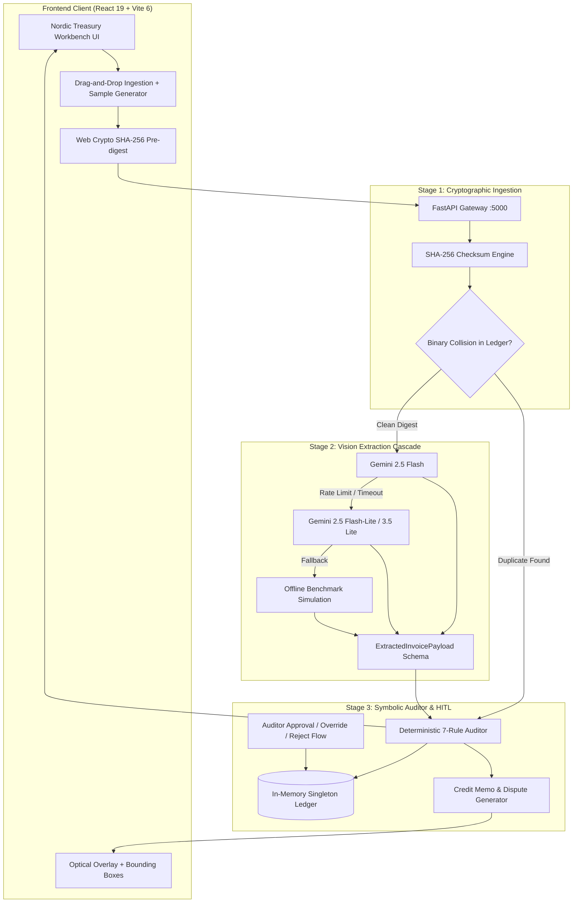

# AuditFlow

**Enterprise B2B Accounts Payable (AP) 3-Way Reconciliation & Cryptographic Forensic Auditing Platform**  
*Built for the NYLP AI Hackathon 2026 (Official Build Window: October 17–19, 2026)*

[](LICENSE)
[](http://localhost:5173)
[](http://localhost:5000)
[](https://stitch.withgoogle.com)

---

## 1. Executive Summary

Enterprise finance and Accounts Payable (AP) departments lose an estimated $3.1 trillion globally each year to invoice processing leakage, vendor unit-price overcharges, unauthorized rush surcharges, and fraudulent duplicate billings. 

While manual 3-way matching (Invoice vs. Purchase Order vs. Receiving Report) is labor-intensive and prone to fatigue, traditional LLM-based solutions fail in production because generative language models hallucinate arithmetic calculations and lack deterministic cryptographic guarantees.

**AuditFlow** solves this through a **3-Stage Hybrid Neuro-Symbolic Architecture**:
1. **Stage 1 — Cryptographic Ingestion:** Rapid `SHA-256` hashing and binary deduplication directly against an immutable ledger.
2. **Stage 2 — Multimodal Vision Extraction with Multi-Model Cascade:** Zero-temperature multimodal vision extraction via the official `google-genai` SDK (`gemini-2.5-flash` cascading through `gemini-2.5-flash-lite`, `gemini-3.5-lite`, and `gemini-2.0-flash-lite` with a 45-second extended timeout and deterministic simulation fallback) that performs semantic line mapping without arithmetic risk.
3. **Stage 3 — Pure-Python 7-Rule Deterministic Auditor:** Zero LLM math. A pure Python engine performs all arithmetic, variance calculation, and tolerance verification down to the exact cent, automatically drafting formal dispute notices and powering a human-in-the-loop forensic workbench.

---

## 2. System Architecture



---

## 3. Engineering Team & Attribution

| Engineer | Role & Workspace | Core Responsibilities |
| :--- | :--- | :--- |
| **Ubaid Raza** | Lead Frontend & UX Architect (`/frontend`) | React 19 architecture, Nordic Institutional Banking design system, split-screen forensic workbench, optical overlays, ⌘K command palette, client-side Web Crypto hashing. |
| **Anushka Samad** | Lead Backend & Forensic Systems Architect (`/backend`) | FastAPI service layer, Google GenAI SDK multi-model cascade, deterministic 7-rule mathematical auditor, thread-safe in-memory ledger, automated dispute generator. |

---

## 4. Quick Start & Dual-Terminal Setup

AuditFlow is structured as a clean monorepo with isolated execution environments.

### Prerequisites
- **Node.js**: v18.0.0 or higher
- **Python**: v3.11 or higher
- **Gemini API Key**: (Optional, system includes deterministic simulation fallback if unset)

### Terminal 1: Backend API Service
```bash
# Navigate to backend directory
cd backend

# Create and activate Python virtual environment
python -m venv venv
# On Windows:
.\venv\Scripts\activate
# On macOS/Linux:
source venv/bin/activate

# Install dependencies
pip install -r requirements.txt

# (Optional) Setup Gemini/Google AI Studio API Key
export GEMINI_API_KEY="your-api-key-here"
# On Windows PowerShell:
$env:GEMINI_API_KEY="your-api-key-here"

# Start FastAPI Uvicorn Server on port 5000
python -m uvicorn app.main:app --host 0.0.0.0 --port 5000 --reload
```
*Backend runs at `http://localhost:5000` (API documentation at `http://localhost:5000/docs`).*

### Terminal 2: Frontend Client
```bash
# Navigate to frontend directory
cd frontend

# Install dependencies
npm install

# Start Vite dev server on port 5173
npm run dev
```
*Frontend runs at `http://localhost:5173`.*

---

## 5. Repository Documentation Index

All architectural contracts, domain rules, schemas, and specifications are locked in `/docs`:

1. [`docs/01_PRD.md`](docs/01_PRD.md) — Product Requirements Document, user persona, and live KPIs.
2. [`docs/02_DOMAIN_AND_BUSINESS_RULES.md`](docs/02_DOMAIN_AND_BUSINESS_RULES.md) — Specification of the 7 deterministic auditing rules and state transitions.
3. [`docs/03_DATA_DICTIONARY_AND_JSON_CONTRACT.md`](docs/03_DATA_DICTIONARY_AND_JSON_CONTRACT.md) — Exact JSON payloads, schemas, and REST endpoints.
4. [`docs/04_USER_FLOW_AND_JOURNEY.md`](docs/04_USER_FLOW_AND_JOURNEY.md) — End-to-end user workflows and 1-click benchmark scenario paths.
5. [`docs/05_UI_WIREFRAMES_AND_SKELETON.md`](docs/05_UI_WIREFRAMES_AND_SKELETON.md) — Stitch UI screen geometry, layout breakdown, and component tree.
6. [`docs/06_SYSTEM_ARCHITECTURE.md`](docs/06_SYSTEM_ARCHITECTURE.md) — Technical architecture, thread safety, and security.
7. [`docs/07_DATABASE_SCHEMA_AND_SEED_DATA.md`](docs/07_DATABASE_SCHEMA_AND_SEED_DATA.md) — Complete PO baselines and 6 benchmark seed invoices.
8. [`docs/08_AI_PIPELINE_AND_PROMPTS.md`](docs/08_AI_PIPELINE_AND_PROMPTS.md) — Multimodal GenAI vision prompt engineering and multi-model cascade strategy.

---

## 6. License
Built for the NYLP AI Hackathon 2026. Distributed under the MIT License.
