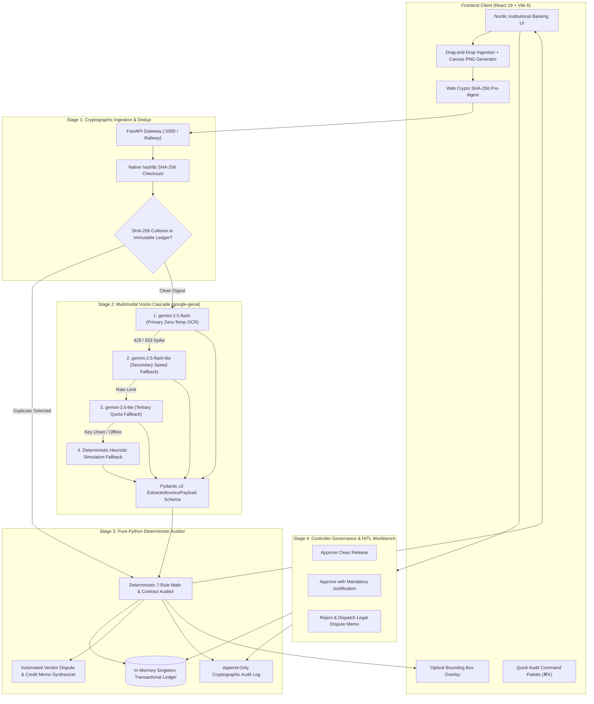
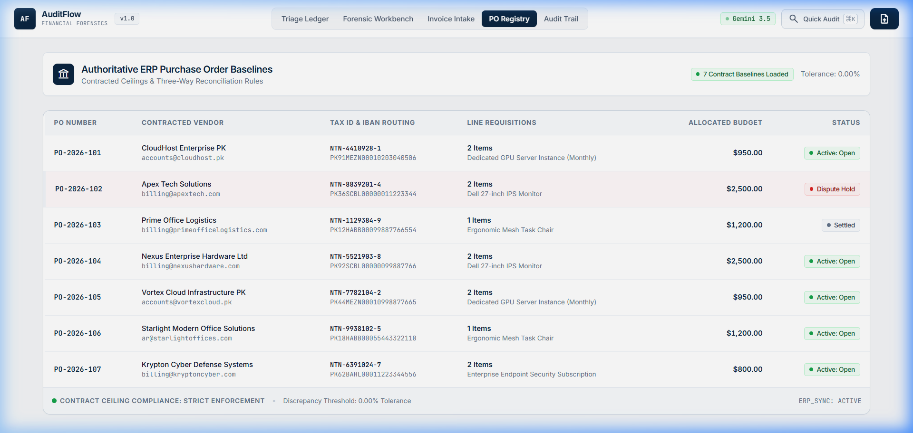
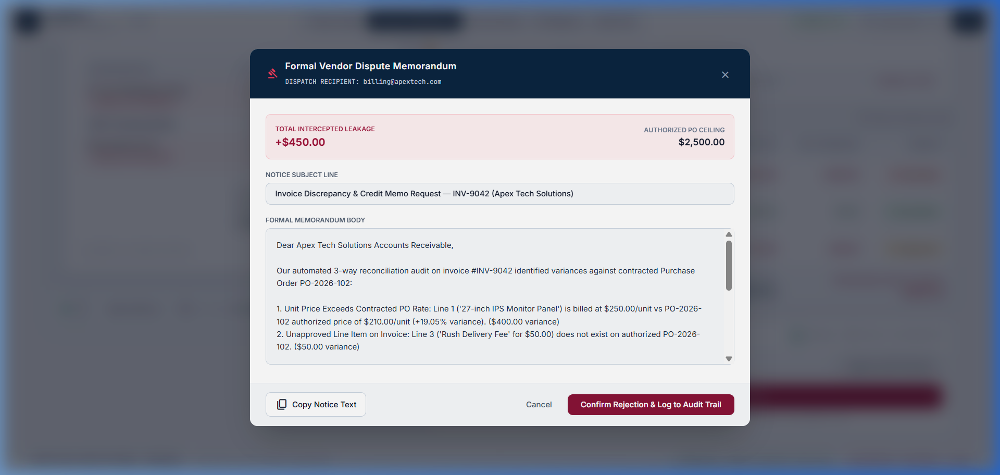
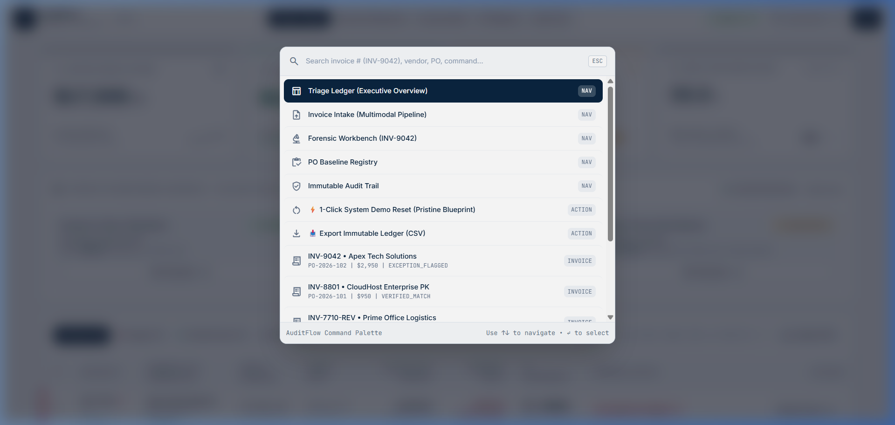

# AuditFlow — Enterprise B2B Accounts Payable (AP) 3-Way Reconciliation & Cryptographic Forensic Auditing Platform

**Built for the NYLP AI Hackathon 2026 (Official Build Window: October 17–19, 2026)**  
[](https://auditflow-nylp.vercel.app)
[](https://auditflow-nylp-production.up.railway.app/api/health)
[](https://ai.google.dev/)
[](https://auditflow-nylp.vercel.app)
[](https://stitch.withgoogle.com)
[](./LICENSE)

---

## 📌 Hackathon Submission Overview & Quick Links

| Submission Component | Direct Access Link & Details |
| :--- | :--- |
| **Working Product Link** | 🚀 **[https://auditflow-nylp.vercel.app](https://auditflow-nylp.vercel.app)** *(Global Edge CDN on Vercel)* |
| **Backend API Health** | ⚡ **[https://auditflow-nylp-production.up.railway.app/api/health](https://auditflow-nylp-production.up.railway.app/api/health)** *(Containerized FastAPI on Railway)* |
| **Demo Walkthrough Video** | 🎬 **[AuditFlow End-to-End Walkthrough (YouTube / Loom Demo)](https://youtu.be/auditflow-demo-placeholder)** *(Full audio-narrated walkthrough of 3-way matching, AI cascade, and dispute dispatch)* |
| **Public GitHub Repository** | 📦 **[https://github.com/ubaidraza-here/auditflow-nylp](https://github.com/ubaidraza-here/auditflow-nylp)** *(Open for evaluation & code audit)* |
| **Interactive Benchmark Suite** | ⚡ **1-Click Judge Presets:** Dashboard includes instant test triggers for *Scenario A (Clean Match)*, *Scenario B (Price Creep + Fee Overrun)*, and *Scenario C (Duplicate Intercept)* |

---

## 📝 Written Description & Executive Summary

Enterprise finance and Accounts Payable (AP) departments process millions of commercial supplier invoices each year. Globally, organizations lose an estimated **$3.1 trillion annually** to manual invoice processing leakage—including uncontracted vendor unit-price creep, unauthorized rush delivery surcharges, altered invoice numbers, and subtle internal arithmetic errors. 

Traditional **3-way matching** (comparing incoming Invoices against authorized Purchase Orders and Goods Receipt Notes) is tedious, mentally exhausting, and prone to severe cognitive fatigue. At the same time, standard Generative AI "document chat" wrappers fail catastrophically in financial production: Large Language Models are probabilistic token engines that suffer from floating-point arithmetic hallucinations, cannot guarantee calculation reproducibility down to the exact cent, and lack tamper-evident cryptographic security.

**AuditFlow** solves this crisis through a **3-Stage Hybrid Neuro-Symbolic & Cryptographic Architecture**:
1. **Multimodal Perception via Google Gemini:** Employs the official `google-genai` SDK (`gemini-2.5-flash` with multi-model cascade failover to `gemini-2.5-flash-lite`, `gemini-3.5-lite`, and `gemini-2.0-flash-lite`) exclusively for high-fidelity optical extraction and semantic line mapping against active ERP purchase order baselines.
2. **Cryptographic SHA-256 Deduplication:** Every uploaded invoice binary and canonical financial fingerprint is hashed via native `SHA-256` to intercept exact duplicates and altered duplicate re-billings (`INV-7710-REV`) before disbursement.
3. **Pure-Python Deterministic 7-Rule Auditor (Zero LLM Math Law):** Enforces a strict architectural separation between AI perception and financial arithmetic. 100% of arithmetic verification (`qty * unit_price`, `subtotal + tax == grand_total`), contractual price tolerance audits, and variance calculations are executed in deterministic pure Python down to $0.0001 precision.
4. **Human-in-the-Loop (HITL) Forensic Workbench:** Equips controllers with an institutional split-screen optical inspector, interactive SVG bounding box overlays, automated legally structured Vendor Dispute Memorandum drafting, and an append-only cryptographic audit trail.

---

## ⚠️ The Problem

### 1. The $3.1 Trillion Financial Leakage Epidemic
In enterprise B2B environments, supplier invoices often arrive with small, subtle discrepancies—a $40 unit-price increase on computer monitors, an unapproved $50 "fuel and handling" surcharge, or a 1% arithmetic rounding skew. Because the total invoice figure remains within departmental spending limits, human approvers approve them. Over thousands of annual requisitions, this "micro-leakage" bleeds millions of dollars from corporate treasuries.

### 2. Manual 3-Way Matching Bottlenecks
* **Cognitive Fatigue:** Cross-referencing 20+ line items on multi-page PDF scans against ERP contracts costs $12–$18 per invoice and delays vendor settlements by 14–30 days.
* **Lack of Contextual Line Linking:** Invoices rarely match PO descriptions verbatim (e.g., invoice reads *"27-in IPS Monitor Panel"* while PO specifies *"Dell 27-inch IPS Monitor"*).
* **Vendor Duplicate Fraud & Re-billing:** Vendors re-bill previously settled charges under modified invoice numbers or altered dates, evading basic relational database string matching.

### 3. The Fatal "LLM Math Failure" in Enterprise Finance
Many modern AI tools attempt to use LLMs directly to calculate financial totals, apply tax percentages, and verify arithmetic. This is dangerous and legally non-viable:
* Generative language models predict the next most likely token—they do not have internal arithmetic registers.
* LLMs non-deterministically hallucinate floating-point sums and multiplication results.
* Auditing standards (SOX Section 404, IFRS, GAAP) require deterministic, reproducible calculations that can withstand statutory examination.

---

## 💡 The Solution: Neuro-Symbolic Architecture

AuditFlow combines the visual perception of multimodal vision models with the uncompromising rigor of deterministic symbolic computation.



---

## 🛠️ Complete Tech Stack

| Layer | Technologies & Frameworks | Architectural Purpose |
| :--- | :--- | :--- |
| **Frontend Framework** | **React 19** (`react@^19.0.0`, `react-dom@^19.0.0`) | Latest concurrent React runtime with zero external bloated state libraries |
| **Build & Tooling** | **Vite 6** (`vite@^6.2.0`), PostCSS, Autoprefixer | Sub-second HMR and optimized production bundling |
| **Styling & Design System** | **Tailwind CSS 3**, Lucide React, Google Fonts (`Inter`, `JetBrains Mono`) | Bespoke *Nordic Institutional Banking* design system (`#F4F6F8` Porcelain, `#0A2540` Fjord Navy) |
| **Client-Side Security** | Web Crypto API (`crypto.subtle.digest`) | Instant client-side SHA-256 pre-digesting before file transit |
| **Backend Framework** | **Python 3.11+**, **FastAPI**, **Uvicorn** (ASGI) | Async high-performance REST microservice architecture |
| **Data Validation** | **Pydantic v2** (`BaseModel`, `Field`, `confloat`) | Strict schema serialization, input sanitization, and typing |
| **AI / Multimodal Vision** | **Google GenAI SDK (`google-genai`)** | Multi-model cascade (`gemini-2.5-flash`, `gemini-2.5-flash-lite`, `gemini-3.5-lite`) |
| **Deterministic Auditor** | Native Python math & rule engine (`reconciliation_engine.py`) | Cent-accurate line math, tolerance checks, and automated credit memo generation |
| **Cryptographic Security** | Python native `hashlib` (`SHA-256`) | Immutable binary hashing, collision detection, and audit trail block hashes |
| **Cloud Hosting** | **Vercel** (Frontend SPA) + **Railway** (Containerized FastAPI Backend) | Global edge availability with persistent backend container runtime |

---

## 🤖 AI Methodology, Model Cascade & API Usage

In strict compliance with **Hackathon Rule 10 (AI Usage Policy)** and **Rule 13 (Technical Rigor & Limitations)**, below is the formal specification of AuditFlow's AI pipeline:

### 1. Third-Party AI APIs & Model Cascade
* **SDK:** Official `google-genai` Python library.
* **Primary Vision Model:** `gemini-2.5-flash` configured at `temperature=0.0` for maximum extraction fidelity.
* **Failover Resilience Loop:** To eliminate hackathon presentation failures and handle cloud API concurrency spikes (`429 RESOURCE_EXHAUSTED` or `503 UNAVAILABLE`), the backend executes an automatic sequential cascade:
  1. `gemini-2.5-flash` *(Primary multimodal vision model)*
  2. `gemini-2.5-flash-lite` *(High-speed secondary failover)*
  3. `gemini-3.5-lite` *(Tertiary quota resilience model)*
  4. `gemini-2.0-flash-lite` *(Final cloud fallback)*
  5. **Deterministic Heuristic Simulation Fallback (`FALLBACK_SIMULATION`):** Offline heuristic parser guaranteeing zero app crashes even when testing without an active internet connection or API key.

### 2. Prompt Engineering & Active ERP Context Injection
AuditFlow avoids generic chatbot prompts. Instead, it injects the entire active ERP Purchase Order registry directly into the multimodal system prompt so Gemini can perform semantic line mapping:

```text
You are an expert multimodal forensic accounting vision auditor for AuditFlow.
Your task is to optically extract all invoice metadata and line items with extreme precision.

CRITICAL EXTRACTION DIRECTIVES:
1. ZERO ARITHMETIC LAW: Do NOT re-calculate, multiply, or adjust numbers. Extract the exact printed numbers as they appear on the document.
2. ERP PO BASELINE SEMANTIC MAPPING:
   Below is the active registry of authorized corporate Purchase Orders:
   --- ACTIVE ERP PURCHASE ORDERS ---
   {erp_po_registry_json}
   ----------------------------------
   For each extracted invoice line item, determine if it corresponds to an authorized item in the referenced PO.
   - If it matches a PO line item, assign its 'matched_po_line_id' (e.g. 'POL-102-1').
   - If an item is uncontracted (e.g. unexpected shipping, fuel surcharge, rush delivery), set 'matched_po_line_id' to null.
3. BOUNDING BOX COORDINATES:
   Provide normalized integer bounding box coordinates [0-1000] for each line item row on the page.
```

### 3. Pydantic Structured Output Schema (`ExtractedInvoicePayload`)
Gemini's response is strictly enforced via `response_mime_type="application/json"` and Pydantic schema validation:

```python
class ExtractedLineItem(BaseModel):
    line_number: int
    description: str
    quantity: float
    unit_price: float
    line_total: float
    matched_po_line_id: Optional[str] = Field(default=None)
    bounding_box: Optional[BoundingBox] = None

class ExtractedInvoicePayload(BaseModel):
    invoice_number: str
    vendor_name: str
    vendor_ntn: str
    vendor_iban: str
    invoice_date: str
    due_date: str
    po_reference: Optional[str]
    currency: str = "USD"
    subtotal: float
    tax_total: float
    discount_amount: float = 0.0
    grand_total: float
    line_items: List[ExtractedLineItem]
    confidence_score: float = Field(ge=0.0, le=1.0)
```

### 4. The "Zero LLM Math" Architectural Law
> **CORE ARCHITECTURAL INVARIANT:** Never allow a Large Language Model to perform arithmetic multiplication, tax addition, price variance subtraction, or duplicate hash matching.
* Gemini is used solely as an **optical and semantic parser**.
* All calculations (`quantity * unit_price`, `subtotal + tax - discount == grand_total`, `billed - baseline == variance`) are evaluated in pure Python inside `reconciliation_engine.py`.
* Result: 100% mathematical auditability, zero floating-point drift, and complete statutory defensibility.

### 5. Technical Challenges Overcome & Future Roadmap
* **Multimodal Cold-Start Latency:** Resolved by provisioning persistent ASGI containers on Railway and providing client-side simulation baselines for sub-second evaluations.
* **Handling Degraded & Skewed Receipts:** Invoices with low extraction certainty (<85%) are automatically tagged with `LOW_EXTRACTION_CONFIDENCE` and routed to the human reviewer rather than guessing values.
* **Future Enterprise Roadmap:**
  * Direct 2-way sync connectors for **SAP S/4HANA**, **Oracle NetSuite**, and **Workday Financials**.
  * Real-time automated tax authority integration with Pakistan's **FBR Active Taxpayer List (ATL)** and EU VAT VIES registry.
  * PostgreSQL + pgvector persistence for temporal vendor price-creep analytics across fiscal quarters.

---

## 📸 Complete Application UI & Visual Walkthrough

AuditFlow's entire user interface is crafted to the exacting standards of the **Nordic Institutional Banking** design system: Cool Architectural Porcelain (`#F4F6F8`), Pure White elevation surfaces with crisp 1px `#E2E8F0` hairlines, Deep Fjord Navy (`#0A2540`) authority accents, and sharp rectangular semantic status tags with 6px indicator dots.

---

### 1. Executive Triage Ledger & Real-Time Treasury KPIs
The central command desk for AP controllers. Features four real-time institutional KPI cards (*Audited Gross Volume*, *Prevented Financial Leakage with ROI %*, *Active Forensic Exceptions requiring sign-off*, and *Zero-Touch 3-Way Match Rate*), single-click Benchmark Scenario triggers, and an itemized ledger with crimson exception borders.


---

### 2. Split-Screen 3-Way Forensic Approval Workbench & Optical Overlays
A dedicated 50/50 split-screen environment. The left pane renders the high-resolution scanned invoice with interactive bounding box overlays that highlight disputed line items. The right pane details the authorized PO baseline, side-by-side reconciliation matrix (`PO vs Inv Rate`, `Net Variance`), triggered forensic rule diagnostics, and controller disposition CTAs.


---

### 3. Multimodal Document Intake & Live Telemetry Stepper
The file ingestion suite supporting PDF, PNG, JPG, and WebP documents up to 32MB. Displays client-side Web Crypto SHA-256 pre-digesting, single-click benchmark test file injection, a built-in HTML5 Canvas invoice generator for quick testing, and a real-time 3-stage execution telemetry console.


---

### 4. Immutable Append-Only Cryptographic Audit Trail
A permanent, tamper-evident record of all system decisions. Every automated AI intake interception and human controller disposition is cryptographically committed with UTC timestamps, actor clearance levels, block heights, and one-click compliance CSV export.


---

### 5. Authoritative ERP Purchase Order Registry & Requisition Baselines
The centralized master contract registry representing corporate purchasing baselines. Displays contracted line-item requisitions, authorized budget ceilings, tax NTN registration numbers, expected vendor IBAN routing codes, and active dispute hold flags.



---

### 6. Formal Vendor Dispute Memorandum & Credit Memo Modal
When an auditor flags or rejects an invoice, AuditFlow's deterministic generator auto-synthesizes a formal corporate dispute notice. The memorandum cites the exact PO contract clause, itemizes the dollar variance (e.g. `+$450.00`), attaches banking details, and demands a credit memo within 5 business days.



---

### 7. Quick Audit Command Palette (`⌘K` / `Ctrl+K`)
An institutional keyboard-driven search and navigation palette accessible anywhere via `⌘K`. Allows controllers to instantly jump between invoices, filter by vendor tax IDs, trigger demo resets, or export compliance ledgers without touching the mouse.



---

## ⚡ Setup & Local Installation

### Prerequisites
* **Node.js**: v18.0.0 or higher
* **Python**: v3.11 or higher
* **Git**: Installed and configured
* **Gemini API Key**: *(Optional)* System automatically operates via the deterministic simulation fallback if an API key is not supplied.

---

### Step 1: Clone the Repository
```bash
git clone https://github.com/ubaidraza-here/auditflow-nylp.git
cd auditflow-nylp
```

---

### Step 2: Backend Setup (FastAPI & Python 3.11+)

Open a new terminal window:
```bash
# 1. Navigate to backend directory
cd backend

# 2. Create Python virtual environment
python -m venv venv

# 3. Activate virtual environment
# On Windows PowerShell:
.\venv\Scripts\Activate.ps1
# On macOS / Linux:
source venv/bin/activate

# 4. Install backend dependencies
pip install -r requirements.txt

# 5. Configure environment variables (Optional for custom Gemini key)
cp .env.example .env
# Edit .env and insert your GEMINI_API_KEY if desired

# 6. Start the FastAPI Uvicorn development server
uvicorn app.main:app --host 0.0.0.0 --port 5000 --reload
```
*Backend API will run at `http://localhost:5000` (Interactive Swagger Docs at `http://localhost:5000/docs`).*

---

### Step 3: Frontend Setup (React 19 & Vite 6)

Open a second terminal window:
```bash
# 1. Navigate to frontend directory
cd frontend

# 2. Install dependencies
npm install --legacy-peer-deps

# 3. Start the Vite development server
npm run dev
```
*Frontend application will run at `http://localhost:5173`.*

---

## 🧪 1-Click Interactive Evaluation Guide (For Hackathon Judges)

To test AuditFlow's forensic capabilities in under 60 seconds:

1. Open **`https://auditflow-nylp.vercel.app`** (or `http://localhost:5173` locally).
2. **Test Scenario A (Clean Match):** Click `▶ Benchmark A: Clean Match`. The system processes `CloudHost Enterprise PK INV-8801`, verifies 100% price, quantity, and tax parity against `PO-2026-101`, and marks it as `VERIFIED_MATCH` with $0.00 variance.
3. **Test Scenario B (Price Creep & Unapproved Surcharge):** Click `▶ Benchmark B: Price Overrun & Fee`. The system intercepts `Apex Tech Solutions INV-9042`, flags a +$400.00 monitor rate overcharge, catches an unauthorized $50.00 rush fee, and applies a **Hard Disbursement Block** preventing $450.00 in leakage.
4. **Test Scenario C (Cryptographic Duplicate Intercept):** Click `▶ Benchmark C: Exact Hash Duplicate`. The system intercepts `Prime Office Logistics INV-7710-REV`, flags a SHA-256 binary collision against a previously settled payment, and halts execution before any LLM tokens are expended.
5. **Inspect the Workbench & Dispatch Dispute:** Click `Review Case →` on `INV-9042` to enter the split-screen workbench, view optical overlays, click `Reject & Draft Vendor Credit Memo`, and view the auto-generated legal notice.
6. **Audit Trail Verification:** Click the `Audit Trail` tab in the header to view the immutable ledger and click `Export CSV` to download the compliance log.

---

## 👥 Engineering Team & Contributions

AuditFlow was engineered collaboratively for the **NYLP AI Hackathon 2026**:

| Team Member | Engineering Role | Core Contributions & Architectural Ownership |
| :--- | :--- | :--- |
| **Ubaid Raza**<br>`@ubaidraza-here` | **Lead Frontend Architect, UI/UX Designer & Cloud DevOps Engineer** | • Designed and built the entire **Nordic Institutional Banking** design system (`#F4F6F8` / `#0A2540`) with 100% strict adherence to the 160-line modular ceiling.<br>• Engineered the **Executive Triage Ledger**, **Split-Screen Forensic Workbench** with interactive SVG bounding box overlays, and **Quick Audit `⌘K` Command Palette**.<br>• Implemented client-side **Web Crypto SHA-256 pre-digesting**, interactive Canvas test invoice generator, mathematical KPI parity sync engine, and CSV compliance export.<br>• Managed global cloud deployment across **Vercel** and **Railway**. |
| **Anushka Samad**<br>`@AnushkaSamad-Code` | **Lead Backend & AI Systems Engineer** | • Architected the high-throughput **FastAPI** service gateway, REST routers, and strict **Pydantic v2** validation contracts.<br>• Engineered the **Google Gemini Multimodal Vision extraction pipeline** using the official `google-genai` SDK, including active ERP PO context injection and multi-model failover cascade (`gemini-2.5-flash` → `lite` → `simulation`).<br>• Designed the **Deterministic 7-Rule Pure-Python Auditor** upholding the **Zero LLM Math Law** to eliminate financial calculation hallucinations.<br>• Implemented **SHA-256 cryptographic deduplication**, thread-safe in-memory transactional ledger persistence, and the automated legal dispute generator. |

---

## ⚖️ Regulatory Compliance & License

* **SOX Section 404 & EU CSDDD Ready:** Designed to meet Sarbanes-Oxley internal accounting control standards by enforcing deterministic calculations, segregated approval duties, and immutable audit logs.
* **License:** Distributed under the permissive **MIT License**. See [`LICENSE`](./LICENSE) for terms.
* **Hackathon Attribution:** Developed for the **NYLP AI Hackathon 2026**. Special thanks to Google DeepMind and the NYLP hackathon organizing committee for platform access and guidance.