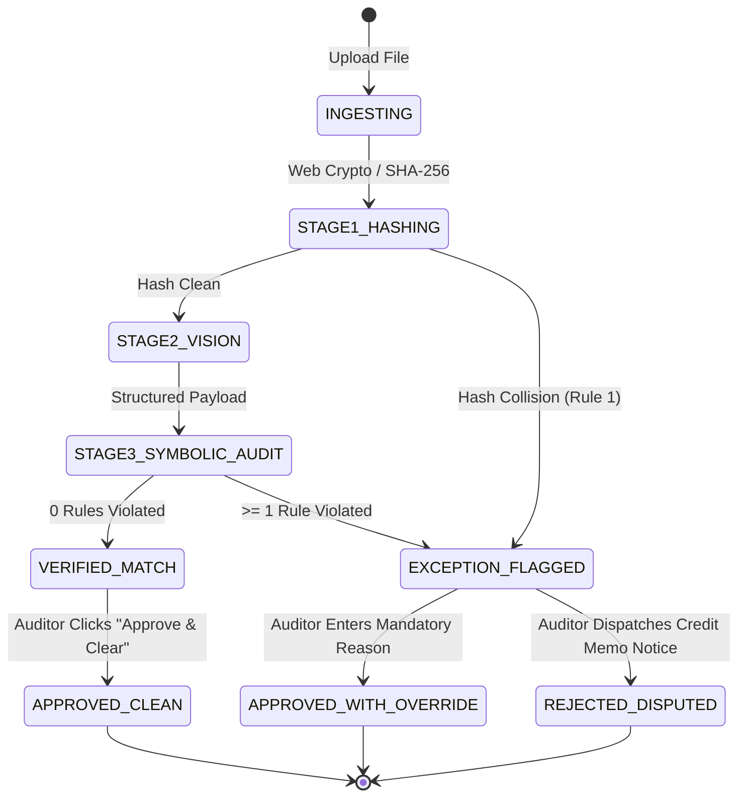

# Domain & Business Rules: The 7-Rule Deterministic Auditor

**Project Name:** AuditFlow  
**Module Reference:** `backend/services/discrepancy_auditor.py`  
**Governing Standard:** Deterministic Python Symbolic Math (No LLM Floating-Point Arithmetic)

---

## 1. Core Architecture Principles

1. **Absolute Separation of Extraction and Auditing:** Multimodal vision models (`gemini-2.5-flash`) are utilized strictly for optical recognition and schema mapping. They are never permitted to compute variances, multiply quantities, or determine rule pass/fail statuses.
2. **Deterministic Rounding Policy:** All floating-point operations use explicit Python `round(value, 2)` arithmetic with a statutory floating-point tolerance of **`$0.02`** (2 cents) to accommodate minor fractional tax rounding variances.
3. **Immutability of Ledger Records:** Once an invoice is evaluated, its cryptographic digest and rule output are immutable until an auditor executes an explicit decision transition.

---

## 2. Specification of the 7 Auditing Rules

### Rule 1: EXACT_FILE_DUPLICATE
- **Severity Level:** `CRITICAL`
- **Execution Stage:** Stage 1 (Pre-extraction Ingestion)
- **Mathematical / Logical Definition:**
  ```python
  computed_hash = hashlib.sha256(file_bytes).hexdigest()
  match = any(inv.sha256_hash == computed_hash for inv in ledger.invoices if inv.id != current_id)
  ```
- **Trigger Condition:** `match == True`
- **Business Rationale:** Prevents payment fraud or clerical error where the identical invoice document file is uploaded multiple times across accounts.
- **System Action:** If an exact binary match is detected, the pipeline marks `EXACT_FILE_DUPLICATE`, sets status to `EXCEPTION_FLAGGED`, logs the conflicting invoice ID, and terminates further costly vision API requests.

---

### Rule 2: CRITICAL_FUZZY_DUPLICATE
- **Severity Level:** `CRITICAL`
- **Execution Stage:** Stage 3 (Symbolic Ledger Cross-Check)
- **Normalization Function:**
  ```python
  def normalize_inv_number(inv_str: str) -> str:
      s = inv_str.upper()
      for suffix in ["-REV", "-COPY", "-V2", "-V1", "_COPY", "_REV", "-DUPLICATE"]:
          s = s.replace(suffix, "")
      return re.sub(r"[\s\-_/]", "", s)
  ```
- **Trigger Condition:**
  ```python
  is_fuzzy_dup = any(
      inv.id != current_id
      and normalize_inv_number(inv.invoice_number) == normalize_inv_number(current.invoice_number)
      and inv.vendor_name.lower().strip() == current.vendor_name.lower().strip()
      and abs(inv.grand_total - current.grand_total) < 0.02
      and inv.status in ["APPROVED_CLEAN", "APPROVED_WITH_OVERRIDE", "VERIFIED_MATCH"]
      for inv in ledger.invoices
  )
  ```
- **Business Rationale:** Vendors frequently re-issue duplicate invoices with minor string modifiers like `INV-7710-REV` or `INV-7710-COPY` after an original `INV-7710` was already cleared and disbursed.
- **System Action:** Flags `CRITICAL_FUZZY_DUPLICATE`, sets status to `EXCEPTION_FLAGGED`, and references the previously approved parent invoice record.

---

### Rule 3: INTERNAL_MATH_ERROR
- **Severity Level:** `CRITICAL`
- **Execution Stage:** Stage 3 (Intra-Document Symbolic Audit)
- **Equations:**
  1. **Line-Item Calculation Verification:**
     For every line $i \in [1, N]$:
     $$\Delta_{\text{line}, i} = | \text{round}(\text{quantity}_i \times \text{unit\_price}_i, 2) - \text{line\_total}_i |$$
     $$\text{Violation if } \Delta_{\text{line}, i} > 0.02$$
  2. **Grand Total Recomputation:**
     $$\text{Calculated Total} = \text{round}(\sum_{i=1}^N \text{line\_total}_i + \text{tax\_total} - \text{discount\_amount}, 2)$$
     $$\Delta_{\text{grand}} = | \text{Calculated Total} - \text{grand\_total} |$$
     $$\text{Violation if } \Delta_{\text{grand}} > 0.02$$
- **Business Rationale:** Detects fraudulent or erroneous arithmetic manipulation directly within the printed invoice text.

---

### Rule 4: MISSING_OR_INVALID_PO
- **Severity Level:** `HIGH`
- **Execution Stage:** Stage 3 (ERP Baseline Verification)
- **Trigger Condition:**
  ```python
  po_exists = po_reference is not None and po_reference.strip().upper() in erp_po_registry
  ```
- **Violation:** `po_exists == False` or `po_reference == ""`
- **Business Rationale:** Enterprise compliance mandates that no disbursement can proceed without a legally binding Purchase Order issued prior to procurement.

---

### Rule 5: 3-WAY RECONCILIATION RULES (PRICE, QUANTITY, UNAPPROVED)
- **Severity Level:**
  - `UNIT_PRICE_OVERCHARGE`: `CRITICAL`
  - `QUANTITY_EXCEEDED`: `HIGH`
  - `UNAPPROVED_LINE_ITEM`: `HIGH` (or `WARNING` if total < $25.00)
- **Line Matching Logic:**
  Each extracted invoice line contains a `matched_po_line_id`.
  1. **Unit Price Variance:**
     $$\Delta_{\text{price}} = \text{billed\_unit\_price} - \text{contracted\_unit\_price}$$
     $$\text{Trigger UNIT\_PRICE\_OVERCHARGE if } \Delta_{\text{price}} > 0.005$$
     $$\text{Variance Amount} = \text{round}(\Delta_{\text{price}} \times \text{billed\_quantity}, 2)$$
  2. **Quantity Exceeded:**
     $$\Delta_{\text{qty}} = \text{billed\_quantity} - \text{contracted\_quantity}$$
     $$\text{Trigger QUANTITY\_EXCEEDED if } \Delta_{\text{qty}} > 0.001$$
  3. **Unapproved Line Item:**
     $$\text{Trigger UNAPPROVED\_LINE\_ITEM if } \text{matched\_po\_line\_id is NULL or not found in PO lines}$$

---

### Rule 6: BANK_ACCOUNT_MISMATCH
- **Severity Level:** `CRITICAL`
- **Execution Stage:** Stage 3 (Vendor Master Data Validation)
- **Trigger Condition:**
  ```python
  extracted_account = normalize_bank_str(current.bank_account_or_iban)
  expected_account = normalize_bank_str(erp_vendor.expected_iban)
  mismatch = extracted_account != "" and extracted_account != expected_account
  ```
- **Business Rationale:** AP diversion fraud (Business Email Compromise / invoice bank detail alteration) is the single largest cause of direct financial wire loss. 

---

### Rule 7: LOW_EXTRACTION_CONFIDENCE
- **Severity Level:** `WARNING`
- **Execution Stage:** Stage 2 / Stage 3 Hand-off
- **Trigger Condition:**
  $$\text{confidence\_score} < 0.85$$
- **Business Rationale:** If OCR quality is degraded, skewed, or blurred, low-confidence fields require human verification before disbursement.

---

## 3. Invoice State Machine & Auditor Decision Transitions



### Transition Specifications:
1. `APPROVE_CLEAN`: Permitted when `status == "VERIFIED_MATCH"`. Moves to `APPROVED_CLEAN`. Sets `disposition = "CLEARED_FOR_DISBURSEMENT"`.
2. `APPROVE_WITH_OVERRIDE`: Permitted when `status == "EXCEPTION_FLAGGED"`. Requires non-empty `override_reason` (min 10 characters). Sets `status = "APPROVED_WITH_OVERRIDE"`.
3. `REJECT_DISPUTE`: Permitted when `status == "EXCEPTION_FLAGGED"`. Generates dispute memorandum via `dispute_generator.py`. Sets `status = "REJECTED_DISPUTED"`.
4. `RESET`: Reverts invoice to its virgin analyzed state.
