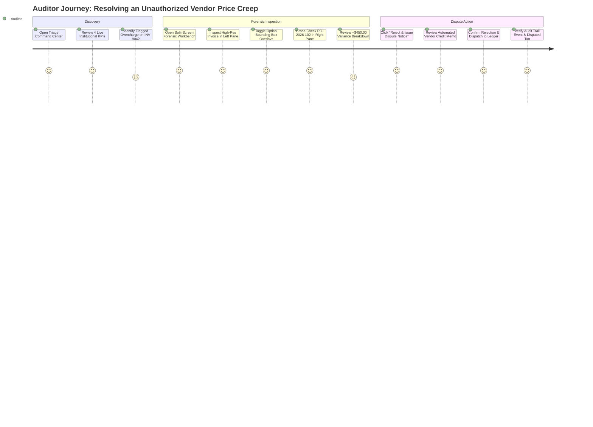

# User Flows & Auditing Journeys

**Project Name:** AuditFlow  
**Standard:** Enterprise B2B AP 3-Way Forensic Investigation & Settlement

---

## 1. Journey Overview & High-Level State Flow

AuditFlow provides end-to-end guidance for treasury controllers and AP forensic auditors from raw invoice intake to final dispute or settlement disbursement:

---

## 2. Journey 1: Triage Command Center & 1-Click Benchmark Scenarios

### 2.1. Initial Triage Experience
1. **Entry Point:** Auditor loads `http://localhost:5173`.
2. **KPI Banner:** The auditor immediately verifies the 4 live institutional KPIs:
   - **Total Audited Volume:** `$142,850.00`
   - **Prevented Leakage:** `$4,320.50`
   - **Pending Exceptions:** `2` (Dynamic)
   - **Clean Match Rate:** `75.0%`
3. **Institutional Triage Ledger:**
   - Auditor observes the dense table sorted by status and variance.
   - High-risk records (`INV-9042` with `+$450.00`, `INV-7710-REV` duplicate) feature sharp Rose rectangular tags (`EXCEPTION FLAGGED`).
   - Clean records (`INV-8801`) display sharp Emerald tags (`VERIFIED MATCH`).

### 2.2. 1-Click Benchmark Evaluation Controls
To allow hackathon judges and executive evaluators to verify the neuro-symbolic pipeline instantly without finding test files:
- Three 1-click benchmark action cards reside above the ledger:
  - **Benchmark A (Clean Match):** Runs `PO-2026-101` vs `INV-8801` ($950.00, 100% matched, zero variance).
  - **Benchmark B (Price Creep & Surcharge):** Runs `PO-2026-102` vs `INV-9042` (Monitor billed at $250 vs $210 PO + $50 uncontracted rush fee; variance `+$450.00`).
  - **Benchmark C (Fuzzy Duplicate):** Runs `INV-7710-REV` against previously settled `INV-7710` ($1,200.00 duplicate collision).
- Clicking any benchmark sends `POST /api/invoices/analyze`, triggers the live 3-stage stepper, and immediately routes the user to the Forensic Workbench.

---

## 3. Journey 2: Split-Screen Forensic Workbench & Optical Overlay

### 3.1. Dual-Pane Inspection
1. Clicking any row in the ledger opens `http://localhost:5173/workbench/:invoiceId`.
2. **Left Pane (50% Width) — High-Res Document Viewer:**
   - Displays the uploaded invoice (or high-fidelity SVG/Canvas render).
   - Features **Optical Overlay Toggle:**
     - When toggled ON, translucent colored bounding box rectangles overlay the exact pixel coordinates of extracted line items.
     - Green boxes indicate verified lines.
     - Rose/Amber boxes highlight violated lines (e.g. Line 1 Unit Price $250.00 and Line 3 Rush Fee $50.00).
   - Zoom and Pan controls allow magnifying small-print vendor terms.
3. **Right Pane (50% Width) — 3-Way Reconciliation & Rule Console:**
   - **Contract Baseline Card:** Displays ERP PO details (`PO-2026-102`, authorized total `$2,500.00`, vendor NTN, verified IBAN).
   - **Line-by-Line Comparison Grid:** Shows Billed Unit Price vs Contracted PO Price, with tabular delta columns (`+$40.00/ea`, total line variance `+$400.00`).
   - **Rule Violation Diagnostic Cards:** Itemizes triggered rules with severity tags:
     - `[CRITICAL] UNIT_PRICE_OVERCHARGE: Billed $250.00 vs Contracted $210.00`
     - `[HIGH] UNAPPROVED_LINE_ITEM: Rush Delivery Fee ($50.00) not present in PO`

### 3.2. Human-in-the-Loop Decision Actions
At the bottom of the right pane, the auditor has 3 mutually exclusive actions:
1. **Option A: "Approve & Clear for Payment"** (Active only if verified clean).
2. **Option B: "Approve with Override"** (Opens modal requiring a minimum 10-character business justification, e.g. "Approved by VP Logistics for emergency supply chain expedited freight").
3. **Option C: "Reject & Issue Dispute Notice"** (Opens `DisputeEmailModal` via React Portal).

### 3.3. Dispute Notice Modal & Credit Memo Flow
1. Modal mounts on `document.body` with `z-[9999]` and `backdrop-blur-md`.
2. Automatically generates formal vendor letter citing:
   - Vendor billing contact email (`billing@apextech.com`).
   - Contract baseline reference (`PO-2026-102`).
   - Itemized variance audit ($400 unit price overage + $50 uncontracted fee).
   - Net 30 payment clock suspension notice.
   - Formal demand for a $450.00 Credit Memo or revised invoice within 5 business days.
3. Auditor can edit the memorandum, click "Copy Notice Text", or click "Confirm Rejection & Log to Audit Trail".
4. System updates invoice status to `REJECTED_DISPUTED` and records an immutable log entry.

---

## 4. Journey 3: Live Ingestion & In-Browser Sample Generator

1. Auditor navigates to `Invoice Intake` (`/upload`).
2. **Drag-and-Drop Zone:** Accepts `.pdf`, `.png`, `.jpg`, `.webp`.
3. **Client-Side SHA-256 Telemetry:** Web Crypto API computes the file hash locally in < 15ms.
4. **1-Click Sample PNG Generator:**
   - For evaluators without test PDFs, an institutional button *"Generate Test Invoice PNG (INV-9042)"* uses an offscreen HTML5 `<canvas>` to render a high-resolution, photorealistic invoice with crisp typography, line tables, and barcodes.
   - Automatically injects the rendered blob directly into the upload pipeline.
5. **3-Stage Visual Pipeline Stepper:**
   - **Stage 1 (Cryptographic Ingestion):** Computes SHA-256 hash and validates duplicate ledger registry.
   - **Stage 2 (Multimodal Vision Extraction):** Displays active Gemini cascade status (`gemini-2.5-flash`), processing time, and structured schema mapping.
   - **Stage 3 (Pure-Python Deterministic Auditor):** Executes all 7 mathematical rules in < 5ms.
6. Seamless transition directly into the Forensic Workbench for review.

---

## 5. Journey 4: Quick Audit Command Palette (`⌘K`)

1. Pressing `⌘K` (or `Ctrl+K` on Windows) anywhere triggers `QuickAuditModal.jsx`.
2. Features instant keyboard-driven search:
   - Type `INV` or `Apex` to filter invoices.
   - Type `PO` to view active purchase order baselines.
   - Type `Reset` to trigger system re-seeding.
3. Arrow key navigation (`↑`/`↓`) and `Enter` to navigate instantly.
4. `Esc` dismisses the portal.
