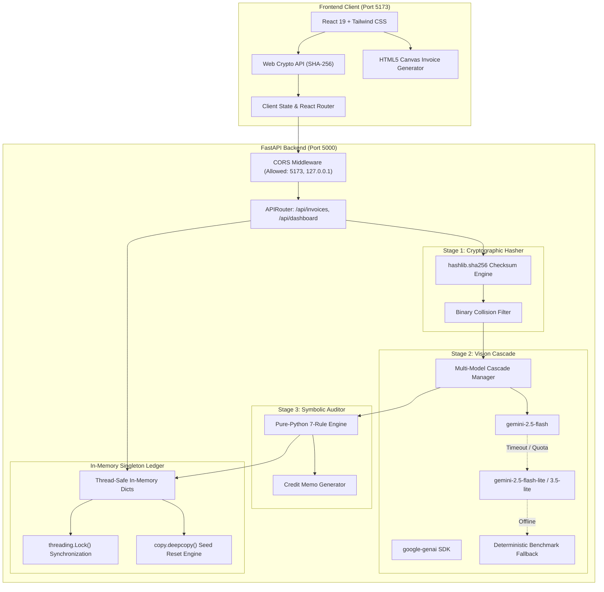

# System Architecture & Technical Specifications

**Project Name:** AuditFlow  
**Version:** 1.0.0  
**Security Standard:** Cryptographic Ledger & Deterministic Validation  
**Backend Lead:** Anushka Samad | **Frontend Lead:** Ubaid Raza

---

## 1. Full-Stack Architectural Topology



---

## 2. Cross-Origin Resource Sharing (CORS) Policy

The FastAPI server initializes CORS middleware to allow frictionless communication with the Vite frontend development server:

```python
from fastapi.middleware.cors import CORSMiddleware

app.add_middleware(
    CORSMiddleware,
    allow_origins=[
        "http://localhost:5173",
        "http://127.0.0.1:5173",
        "http://localhost:3000",
        "http://127.0.0.1:3000",
    ],
    allow_credentials=True,
    allow_methods=["*"],
    allow_headers=["*"],
)
```

---

## 3. Thread-Safe In-Memory Ledger with Deepcopy Reset

To ensure zero external database configuration hurdles while maintaining full thread safety during concurrent requests and judge evaluations:

### 3.1. Synchronization Model
- All read and write operations on the in-memory ledger are guarded by a Python `threading.Lock()` instance.
- Prevents race conditions during simultaneous benchmark executions and human decision approvals.

### 3.2. Clean Re-Seed Guarantee (`copy.deepcopy`)
```python
import copy
import threading

class InMemoryLedger:
    def __init__(self):
        self._lock = threading.Lock()
        self.reset()

    def reset(self):
        with self._lock:
            # Reconstruct ledger from pristine seed definitions
            self.purchase_orders = copy.deepcopy(SEED_PURCHASE_ORDERS)
            self.invoices = copy.deepcopy(SEED_INVOICES)
            self.audit_logs = copy.deepcopy(SEED_AUDIT_LOGS)
```
- Calling `POST /api/invoices/reset` executes `self.reset()`, guaranteeing that tests leave no dirty state.

---

## 4. Cryptographic SHA-256 Pipeline

### 4.1. Client-Side Web Crypto Pre-Digest
Before uploading invoice bytes across the network, the browser client computes the file hash using the browser's native Web Crypto API:
```javascript
export async function computeClientSHA256(file) {
  const arrayBuffer = await file.arrayBuffer();
  const hashBuffer = await crypto.subtle.digest('SHA-256', arrayBuffer);
  const hashArray = Array.from(new Uint8Array(hashBuffer));
  return hashArray.map(b => b.toString(16).padStart(2, '0')).join('');
}
```

### 4.2. Server-Side Verification
The backend receives raw multipart bytes and verifies the checksum via Python's standard library:
```python
import hashlib

def compute_server_sha256(file_bytes: bytes) -> str:
    return hashlib.sha256(file_bytes).hexdigest()
```
- The server compares `server_hash` against `client_hash` for audit telemetry.
- If an exact hash collision exists in the active ledger, the backend flags Rule 1 (`EXACT_FILE_DUPLICATE`) and bypasses multimodal vision calls.

---

## 5. Security & File Validation Controls
- **Maximum File Size:** 25 Megabytes (26,214,400 bytes).
- **Permitted File Formats:** `image/png`, `image/jpeg`, `image/webp`, `application/pdf`.
- **Sanitization:** All filename strings are sanitized to remove path traversal sequences (`../`, `..\`).
